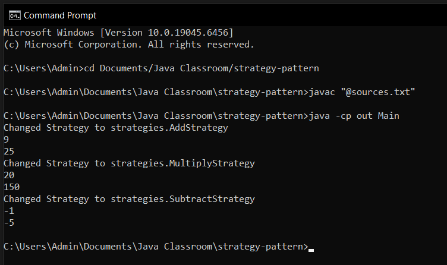

# strategy-pattern
Classroom assignment about strategy pattern implemented in Java.
### How to Run
1. Go to project location with `cd` command.
2. Execute `javac "@sources.txt"`
3. Execute `java -cp out Main`

### How to add new Strategy
1. Add new strategy in `strategies/` folder. It must implement `MathStrategy` and have a `package strategies;` on top of file
2. Use strategy inside `Main.java`.
